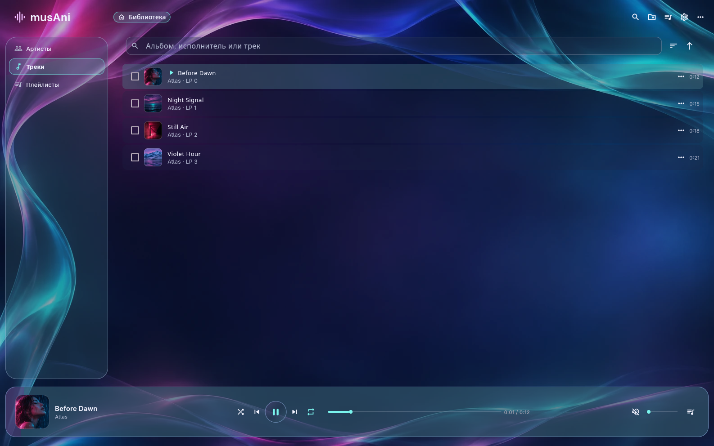
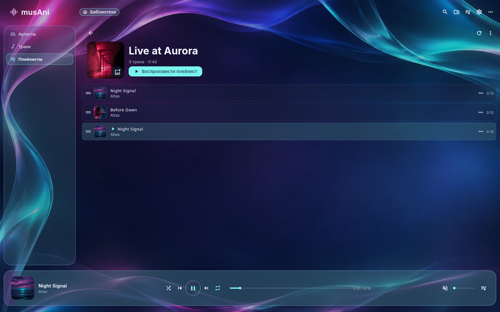

# musAni

musAni is an open-source desktop player for your local music collection.
It runs offline and stores your library, playlists, and preferences on your computer.
The first public alpha is available for **Linux x86-64**.





## Features

- Browse albums, artists, and tracks in a searchable, sortable library with cover art.
  Open albums and artists in tabs without losing your place in the library.
- Play from any position in the current list or playlist. Use the queue, shuffle,
  or repeat a track or the whole queue.
- Create playlists with custom artwork and drag tracks to reorder them. You can
  mark a playlist as an album while keeping the original audio tags.
- Edit MP3 and FLAC tags, including multiple artists and cover art. musAni
  saves a backup before replacing a file.
- Choose Minimal or Atmosphere, a light or dark color scheme, or follow the
  system setting. Visual effects, reduced motion, and keyboard shortcuts
  are configurable.

## Install on Linux

Download the Linux x86-64 archive and its `.sha256` file from
[GitHub Releases](https://github.com/tizeq/musAni/releases).
The player needs glibc 2.34 or later, libstdc++ with `GLIBCXX_3.4.29`,
GTK 3, libmpv, SQLite with JSON support, libcurl, and a working graphical
and audio session.

**Arch Linux**

```sh
sudo pacman -S --needed gtk3 mpv sqlite curl libglvnd mesa
```

**Ubuntu 24.04 LTS** (`libmpv2` is in Universe)

```sh
sudo apt install libgtk-3-0t64 libmpv2 libsqlite3-0 libcurl4t64 libgl1 libegl1 libgles2 libegl-mesa0 libgl1-mesa-dri
```

From your download directory, verify the checksum and extract the whole bundle.

```sh
sha256sum -c musAni-v0.1.0-alpha.1-linux-x86_64.tar.gz.sha256
tar -xzf musAni-v0.1.0-alpha.1-linux-x86_64.tar.gz
cd musAni-v0.1.0-alpha.1-linux-x86_64
./musani
```

Keep `musani`, `lib/`, and `data/` together. You can run the player as a regular
user without installing the Flutter SDK. To import music, select **Добавить
папку** (*Add folder*) and choose a directory. The alpha interface uses Russian.

## Audio formats and alpha limits

- **Playback:** MP3, FLAC, M4A, OGG, WAV, and Opus. Decoding depends on your
  system's libmpv build.
- **Tag editing:** MP3 and FLAC.
- This release targets Linux x86-64 with glibc. Other architectures, musl,
  and other operating systems are outside the scope of this build.
- The library, playlists, and settings survive a restart. The current
  playback queue is session-only. Library refreshes are started manually.
- musAni plays local files. Streaming and cross-device sync are unavailable.

## Report an issue

Open an issue on [GitHub](https://github.com/tizeq/musAni/issues). Include the
musAni version, your Linux distribution, whether you use Wayland or X11,
the file format if playback or tag editing is affected, and steps to reproduce.
Describe what you expected and what happened. Remove personal paths and other
private data from screenshots and logs before attaching them.

## License

The original musAni code is licensed under **GPL-3.0-or-later**.
Bundled libraries, fonts, and artwork have their own terms.
The matching source archive includes the TagLib source and the materials
needed to relink the LGPL bridge.

[License](LICENSE) · [License scope](COPYRIGHT) ·
[Third-party notices](docs/third-party-notices.md) ·
[Source and relinking instructions](docs/linux-source-code.md)
